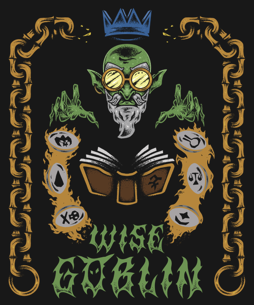
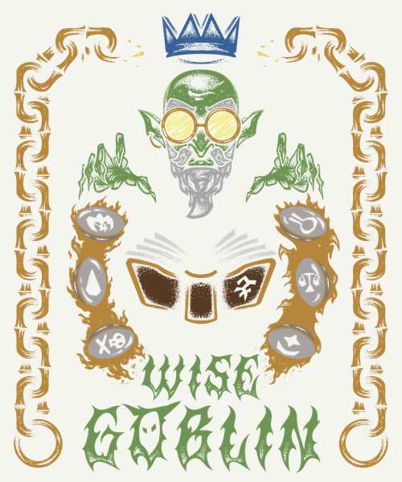

# Wise Goblin Logo

The official Wise Goblin clan logo. Clan members can use it on mugs, shirts, hoodies, stickers, banners or anything else you like.

  

## Download

| File | Size | Use it for |
| --- | --- | --- |
| [wise-goblin-logo.png](logo/wise-goblin-logo.png) | 6000 × 7200 | Print master. Upload this one to print shops. |
| [wise-goblin-logo-trimmed.png](logo/wise-goblin-logo-trimmed.png) | 5711 × 6997 | Same art with the empty border cropped. Handy for mugs and stickers. |
| [wise-goblin-logo-preview.png](logo/wise-goblin-logo-preview.png) | 1000 × 1200 | Discord, forum avatars, websites. |

To download a file, open it and click the **Download raw file** button.

All files are PNGs with a transparent background. That's 20 × 24 in at 300 DPI, which is more than enough for any shirt or mug.

## Printing tips

**Use dark backgrounds.** The black linework in the art is transparent, so whatever is behind it shows through. On black, charcoal, navy or forest green it looks as intended. On white or light colors the face, beard and book lose most of their detail:

| Dark (recommended) | Light |
| --- | --- |
|  |  |

- **Shirts and hoodies:** Choose DTG (direct-to-garment) printing on a dark shirt. Most print-on-demand sites (Printful, Teespring, Redbubble and so on) take the PNG as-is.
- **Mugs:** Pick a black mug or a mug with a black print area. Use the trimmed file.
- **Stickers:** Ask for a black background or a black die-cut border so the linework shows.

## License

Licensed under [CC BY 4.0](LICENSE). Anyone may use, print and adapt the logo, as long as they credit the Wise Goblin clan.
